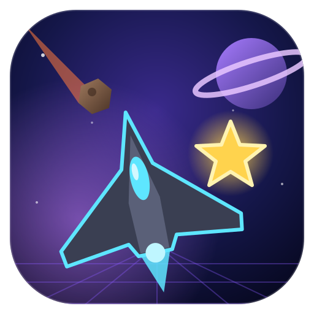
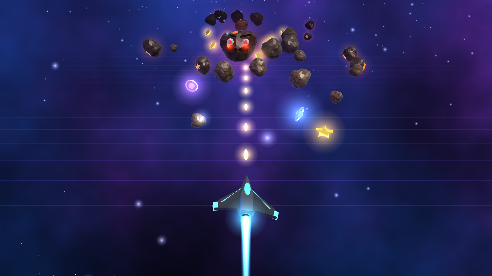

<h1 align="center">STARFALL 3D</h1>

<i>One ship, one pilot, way too many rocks.</i>

An endless 3D arcade shooter that runs in the browser, written in plain WebGL2 with no libraries and no build step. Dodge and shoot meteors, collect stars to chain combos, grab power-ups and survive King Boulder. The game never ends, and every level gets faster.

## Play

Open `index.html` in a modern browser, or enable **GitHub Pages** (Settings → Pages → Deploy from branch → `main` / root) and play at `https://<your-user>.github.io/<repo>/`.

## Controls

| Action | Keyboard | Mouse / touch |
|---|---|---|
| Move | Arrows / WASD | Drag (touch) |
| Shoot | Space / J | Click / auto-fire on touch |
| Pause | P / Esc | |
| Mute | M | 🔊 button |

## Features

- Low-poly 3D ships, rocks and stars with glow effects
- Endless difficulty: rocks get faster and more frequent, zigzag rocks and swarms show up at higher levels
- King Boulder boss fight every 3 levels
- Power-ups: shield, triple shot and extra life
- Star combos up to ×5
- Chiptune music and quiet sound effects, all generated with the Web Audio API
- High score saved in your browser

---

Produced by <b>LTK Games</b>

